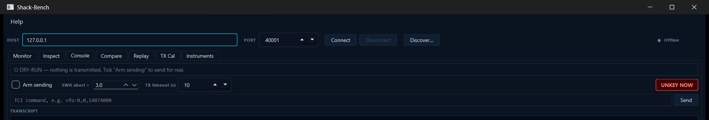
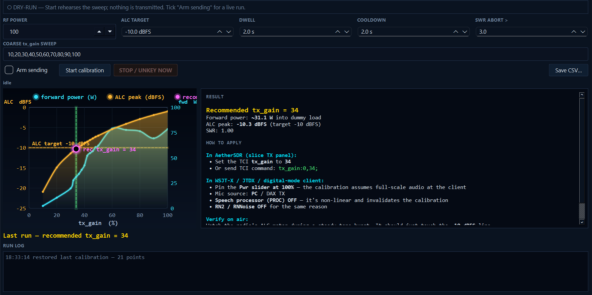
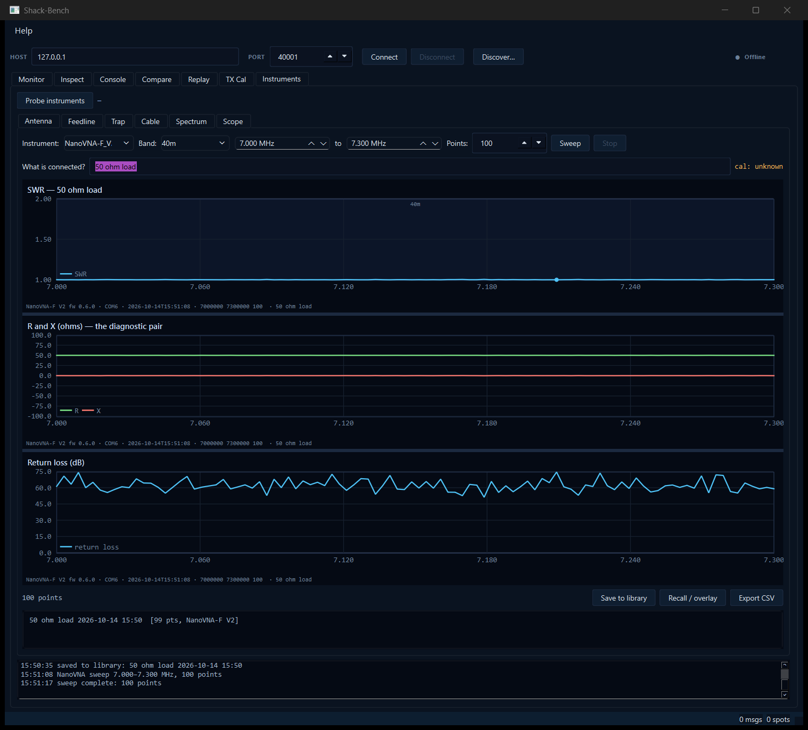
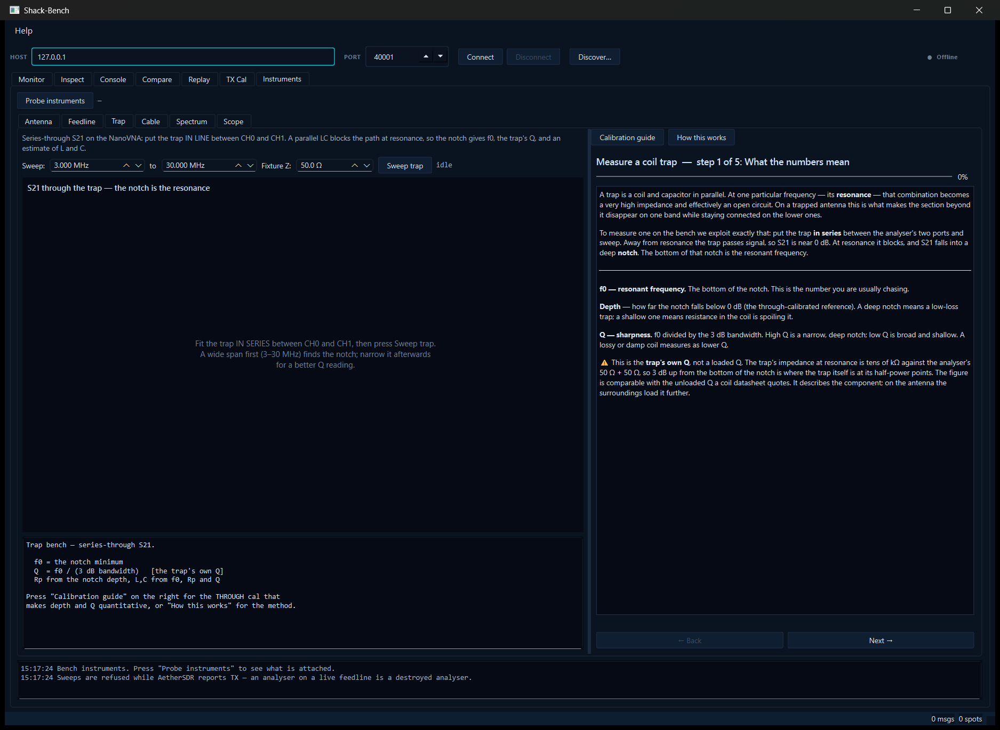
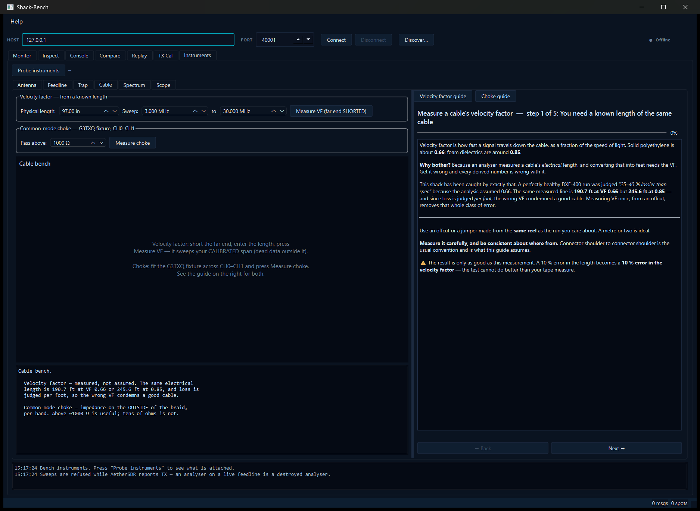
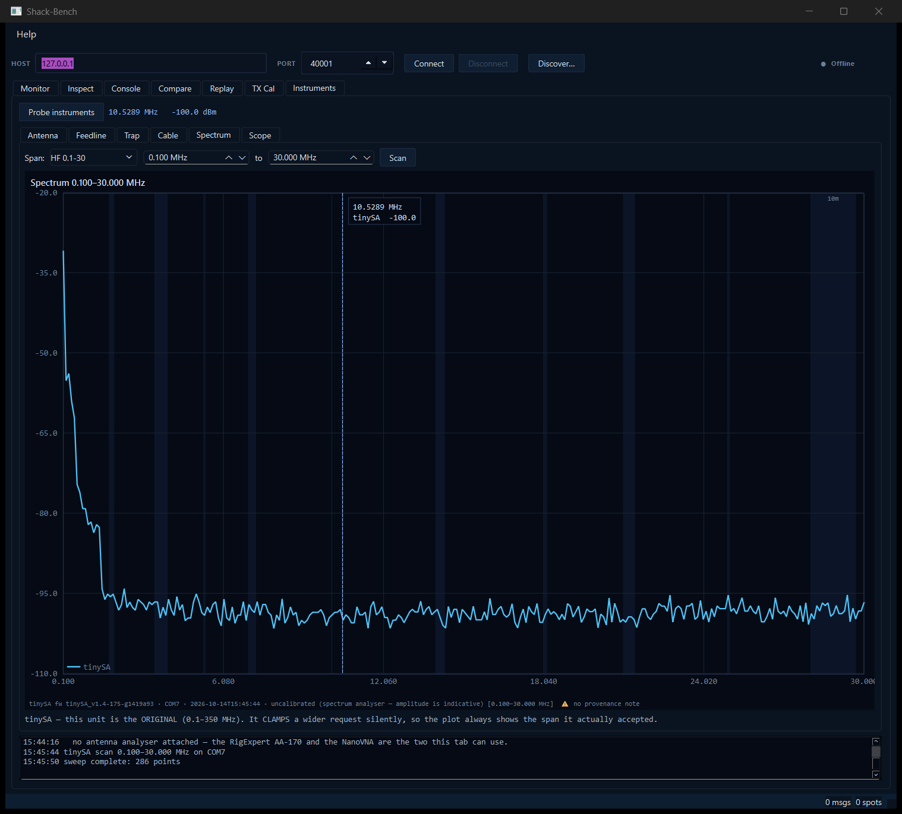

# Shack-Bench

A bench workstation for the radio shack.  It started as **TCI Monitor**, a
diagnostic tool for the **TCI** (Transceiver Control Interface) WebSocket
protocol used by AetherSDR, ExpertSDR2, SunSDR and similar SDR applications,
and grew into a tabbed workbench that also calibrates TX drive and drives
bench test instruments:

- **TCI tools:** watch, inspect, send, compare, record and replay the TCI
  stream, plus antenna SWR sweeps captured over TCI.
- **TX Cal:** closed-loop WSJT-X drive calibration against the radio's ALC.
- **Instruments:** an antenna analyser / VNA, a spectrum analyser and an
  oscilloscope, with dedicated bench tests for feedlines, coil traps,
  cable velocity factor and common-mode chokes, each with a guided
  walkthrough.

## Status

**v0.5.1** (2026-10-14) is a fixes release: TX safety in the console and
TX Cal (no path can leave the radio keyed), corrected trap and choke
maths, instrument Stop that actually stops, scope/NanoVNA parsing fixes,
and a Windows package that bundles the VC++ runtime.  v0.5.0 (2026-08-27)
was the first release under the Shack-Bench name, with installers for
Windows, Linux and macOS.  The TCI tools and TX Cal are
mature and used on air.  The Instruments workspace is new in 0.5 and has
been verified on the instruments listed below and nowhere else; other
models of the same families may need driver work.

## Download

Pre-built binaries — including a Windows installer — are on the
[**Releases page**](https://github.com/nigelfenton/shack-bench/releases/latest):

- **Windows installer** — `ShackBench-Setup-<version>-windows-x64.exe`
  (double-click to install)
- **Windows portable zip** — `ShackBench-<version>-windows-x64.zip`
  (unzip and run `ShackBench.exe`)
- **Linux AppImage** — `ShackBench-<version>-linux-x86_64.AppImage`
  (`chmod +x` and run)
- **macOS DMG (Apple Silicon)** — `ShackBench-<version>-macos-arm64.dmg`

Or build from source — see [Build](#build) below.

## Features

- Connect to any TCI server over WebSocket — host + port, defaults to
  `127.0.0.1:40001` (AetherSDR's TCI default; ExpertSDR2 / SunSDR use 50001)
- Real-time scrolling log of every message received, with timestamps
- Parsed views in the side panel:
  - **Current VFO / mode** — updated as the radio is tuned
  - **Spot table** — every `spot:` event the server emits, with callsign,
    frequency, mode, colour and the spot's description text
  - **SWR scan** — captures an antenna SWR sweep over TCI, buckets it
    per band, overlays bands, and exports CSV
- Save the raw log to a file for offline analysis
- Filter / search the message stream, suppress flooding command types
- Auto-reconnect with backoff if the connection drops
- **Discover…** finds TCI peripherals on the LAN by mDNS
  (`_tci._tcp.local`, AetherSDR's discovery schema); double-click a row to
  fill in host and port.  A service-type selector browses other DNS-SD
  services too.
- **Command reference** (F1): every TCI command with its syntax and a
  description, including AetherSDR's `clicked_on_spot` /
  `rx_clicked_on_spot` (AE #3145), which highlight the matching spot row
- A **toolkit** of diagnostic tabs (see below) for deeper work

## Toolkit tabs

The window is a tabbed workbench: **Monitor**, **Inspect**, **Console**,
**Compare**, **Replay**, **TX Cal** and **Instruments**.  The **Monitor**
tab is the classic view above; the connect bar at the top is shared by the
tabs that observe the live connection.

### Inspect

A structured fold of the stream: one row per command instead of a flat
scroll.  For each command you get a live **count**, a smoothed
**rate/min**, the most-recent **value**, the reference **syntax**, and an
advisory **compliance** flag:

- `ok` — argument count looks consistent with the reference syntax
- `few args (N<M)` — fewer arguments than the syntax declares (suspect)
- `unknown cmd` — not in the built-in command reference (vendor-specific
  or new); informational, not an error

Purely passive — it never sends anything.  "Reset stats" clears the
table.

### Console

A free-text TCI command sender.  This is one of only two parts of
Shack-Bench that can key your radio (the other is TX Cal), so it is deliberately defensive:

- **Dry-run by default.**  The arm state is *not* remembered — it resets
  to OFF every launch.  Unarmed, a command is only logged as
  "would send", never transmitted.
- **TX-class confirm.**  `trx`, `tune`, `cw_msg` and `cw_macros` require a
  second explicit confirmation even when armed, and **every** command on
  a line is checked, so `vfo:…;trx:0,true;` can't slip a key through.
- **Watchdog.**  Keying a carrier starts a watchdog that unkeys every
  receiver the console keyed if SWR exceeds the configured limit or TX
  persists past the timeout.
- **UNKEY NOW.**  Always available, armed or not; unkeying is always safe.
- **Never left keyed.**  Disarming, Disconnect, a lost link or closing the
  app all unkey first.  If the link is down the unkey is queued and sent
  before anything else on reconnect, and the transcript says so rather
  than claiming it was sent.



Command-name autocomplete is driven by the built-in reference table.
Replies arriving shortly after a send are echoed into the transcript so
they line up with the command that caused them.

### Compare

Connects 2–4 **independent, read-only** observers, each with its own
host/port — so you can compare:

- **same server, N observers** — "do all clients see identical frames?"
- **cross-server** — "how do two radios' dialects differ?" (e.g.
  AetherSDR `:40001` vs SunSDR `:50001`)

The **value matrix** shows one row per command and one column per
observer; rows where observers disagree are flagged red.  A merged,
colour-coded stream log underneath gives the timeline.

### Replay

Record the live stream to a capture file, and replay any capture back
as a **local TCI server** so another client (WSJT-X, a logger, a second
Shack-Bench) can connect to it offline — no radio involved.

- **Record** writes a `.tcicap` file (format below).
- **Replay** stands up a `QWebSocketServer` and feeds the file with its
  original inter-message timing.  Speed factor scales the timing; Loop
  restarts at the end.  It also accepts a plain saved raw log
  (timestamps are stripped and a fixed gap is used).

  The server defaults to **port 40010** and binds **127.0.0.1 only** —
  deliberately *not* 40001/50001, and not the LAN, so it can never take
  a live TCI port from the real radio.  Tick **Expose on LAN** to bind
  all interfaces (for WSJT-X on another machine); choosing 40001/50001
  requires an explicit confirm.

### TX Cal

Closed-loop **WSJT-X TX-drive calibration**.  Sweeps `tx_gain` against
the radio's ALC peak meter, finds the highest setting that keeps ALC at
or below a configurable target (default −10 dBFS), and recommends a
single `tx_gain` value to apply.  The injected test tone is generated
inside the panel as TCI TX-audio frames — no external harness required.



The result is shown as a curve (forward power and ALC peak vs `tx_gain`)
alongside a step-by-step "how to apply" panel — including the exact TCI
command, the matching WSJT-X / JTDX settings, and the operator
pre-flight checks (PROC off, RN2 off, dummy load, etc.).

Same defensive model as the Console tab — armed-to-send (resets OFF
each launch), per-keydown SWR/timeout watchdog, always-live
**STOP / UNKEY NOW**.  On a live armed start the panel also auto-sets
the slice to DIGU (and restores the original mode at the end) so
AetherSDR reliably routes TCI audio via the DAX TX path regardless of
the slice's operating mode.

Every saved CSV carries:

- run timestamp
- Shack-Bench build identity (git hash, branch, dirty flag, commit
  date, compile date, host OS — baked at CMake configure time)
- AetherSDR server identity (`device:` / `protocol:` / `software:`)
- a **WARNING** block if forward power stayed at 0 W across the whole
  sweep (no carrier produced → TX audio routing problem in AetherSDR);
  the recommendation is suppressed in that case

Requires an AetherSDR carrying
[aethersdr/AetherSDR#2950](https://github.com/aethersdr/AetherSDR/pull/2950)
(the `tx_gain` TCI command and the `alc` field on `tx_sensors`); the
panel detects a missing `alc` field on the first keyed point and
refuses the run with a clear diagnostic message.

Sampling is defensive: a point that captured fewer than two samples, or
only floor-level ALC with zero power, is re-keyed up to twice before it is
recorded, and dead frames at the key edges are dropped.  If the ALC curve
stays flat across the sweep, the panel reports that as an observation, not
a diagnosis — a steady tone produces constant RF in SSB, so a flat curve
can be entirely innocent.  The test-tone peak is adjustable (default 0.999).

### Instruments

A workspace for bench test equipment, with its own tabs.  **Probe
instruments** finds what is plugged in (off the GUI thread, about 1.3 s for
two instruments) and says which tab each one went to.  Instruments are
identified by asking them, not by USB VID/PID: the NanoVNA and tinySA share
VID_0483/PID_5740.

**Verified instruments**

| Instrument | Link | Used by |
|---|---|---|
| RigExpert AA-170 | USB serial (FTDI), 38400 baud | Antenna |
| NanoVNA-F V2 | USB serial (STM32 CDC) | Antenna, Feedline, Trap, Cable |
| tinySA (original, not Ultra) | USB serial (STM32 CDC) | Spectrum |
| Hantek DSO2D15 | USBTMC via VISA | Scope |

**Guardrails on every sweep:** a calibration-range badge, with out-of-cal
regions hatched; a provenance note required before a sweep can be saved;
a **TX interlock** that refuses to sweep while the radio reports transmit;
a physical-impossibility flag (|Γ| ≥ 1 or SWR < 1 means a bad cal or an
open port, never a bad antenna); and instruments left with RF off.

#### Antenna

SWR, R and X, and return loss from the AA-170 or NanoVNA, on a shared
frequency axis with ham-band shading, markers and a hover readout (SWR
keeps 1:1 at the bottom, so a dip reads as a dip).  Sweeps go to a
**library** to recall and overlay, and export to CSV.



#### Feedline

Open/short analysis of a coax run from two NanoVNA sweeps:

- characteristic impedance, `Z0 = √(Zoc·Zsc)`
- matched loss, `8.686·Re(atanh√(Zsc/Zoc))`, judged against a cable
  catalogue (RG-213/8X/58, LMR-400/DXE-400, LMR-600, hardline) with loss
  interpolated on √f
- electrical length from the reactance zero-crossings of the shorted sweep
  (they fall every **quarter** wavelength), and physical length for a
  stated **velocity factor**, which is an explicit, editable input

It checks that the two sweeps actually invert (a quarter-wave open looks
like a short) and refuses a pair that doesn't, rather than producing
confident numbers from a bad pair.

#### Trap

Characterises a coil trap as a component before it goes on an antenna.  The
trap sits **in series** between CH0 and CH1 of the NanoVNA; the S21 notch
gives **f0**, notch depth, the **trap's own Q**, Rp, and L and C.  It
refuses to report f0 when the minimum is at the sweep edge, calls a notch
under 3 dB "no usable notch", and omits Q when the 3 dB points fall outside
the sweep.

Side panel guides:

- **Calibration guide**: a 9-step full 2-port NanoVNA calibration that
  runs each step for you, sets the span first, waits for each standard to
  settle, **verifies** the cal on the still-fitted load, and only then
  **saves** it to slot 0 so it survives a power cycle.
- **How this works**: f0, depth and Q, why the trap goes in series, and
  sweeping wide then narrow.



#### Cable

Two bench tests, each with its own guide:

- **Velocity factor**: measured from a known length with the far end
  shorted, instead of assumed.  Sweeps a user-set span (default the
  calibrated 3–30 MHz).  It refuses a sweep that is mostly dead data and
  says how long an offcut is needed: a short jumper resonates too high to
  measure in 3–30 MHz.
- **Common-mode choke**: the G3TXQ two-SO-239 fixture (diagram in the
  guide).  Common-mode impedance `Zcm = 2·Z0·(1/S21 − 1)` from the
  **complex** S21 (a choke is mostly reactive, and |S21| alone under-reads
  it), reported **per band** against a 1 kΩ threshold, after measuring the
  empty fixture's floor and ceiling.



#### Spectrum

Amplitude vs frequency from the tinySA.  The driver reads the sweep range
**back** rather than trusting the request: the original tinySA silently
clamps an over-range request (ask for 6 GHz, get 0.1–350 MHz), and the
panel says so.



#### Scope

Waveform capture from the Hantek DSO2D15, with Export CSV (with a full
provenance header) and Save PNG.  Vpp, Vrms, mean and frequency are
**computed** from the samples, and labelled as such: firmware 3.0.1
reports no measurement values.  Frequency is only reported for a swing of
at least half a division.  Verified against the scope's own calibrator
(1 kHz, 4.88–4.96 Vpp).

The scope needs a **VISA runtime** (NI-VISA, Keysight IO Libraries or
similar), loaded at run time.  Without one, the Scope tab says so and every
other tab works normally.

## Capture file format

A `.tcicap` file is plain UTF-8 text:

```
# tcimon-capture v1  2026-05-18T14:32:01
0	protocol:AetherSDR,0.9
12	ready
48	vfo:0,0,14074000
...
```

- The first line is a `#` comment header with the ISO-8601 capture time.
  Any line starting with `#` is ignored on replay.
- Each data line is `<delayMs>` + a TAB + the raw TCI message (no
  trailing `;` — replay re-adds it).  `delayMs` is the gap since the
  previous recorded line; the first line is `0`.

Because the format is just delay-prefixed lines, a saved raw log
(`Save log…`) also replays — its `HH:mm:ss.zzz` prefix is detected and
stripped, and lines play with a fixed default gap.

## Build

Requires Qt 6.2+ with the WebSockets, SerialPort, Network and Svg modules,
CMake 3.20+, and a C++17 compiler.  A VISA runtime is optional (Scope tab
only) and is not needed to build.

```sh
cmake -B build -G Ninja -DCMAKE_BUILD_TYPE=Release
cmake --build build
```

On Windows: `.\build.bat` does the configure + build in one shot. It finds
Visual Studio with `vswhere`; set `QT_DIR` first if your Qt kit isn't at
`C:\Qt\6.10.3\msvc2022_64` (or `VCVARS` to point at a specific
`vcvars64.bat`).

### Tests

```sh
ctest --test-dir build --output-on-failure
```

Four offline suites check the analysis maths against synthetic data with
known answers, plus regressions from real bench measurements:
`coax_analysis_test`, `trap_analysis_test`, `cable_tests_test` and
`scope_decode_test`.  `instrument_probe_test` talks to real hardware and is
built but not run by `ctest`.

## Why standalone?

Originally written to investigate what AetherSDR sends when an operator
clicks a DX-cluster spot on the panadapter — useful information that no
documentation seemed to cover.  Spinning it out as its own tool means it
stays available whenever a TCI question comes up, separate from any
particular logger or controller it might inform.

## License

GPL-3.0-or-later.  See [LICENSE](LICENSE).

73 de G0JKN / W3.
